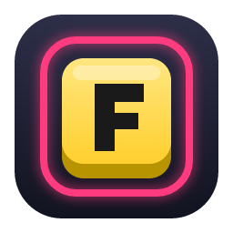

<p align="center">
  
</p>

<h1 align="center">Keynav</h1>

[](https://github.com/waleedrizwan/keynav/actions/workflows/ci.yml)
[](LICENSE)


**Mouse-free browsing for Chrome.** Keynav labels every clickable thing on the page so you can hit it from the keyboard: links, buttons, form fields, and the JavaScript-only "div buttons" that most keyboard tools miss.

- **Private by design.** No network requests, no storage, no analytics. Nothing leaves your browser. See [PRIVACY.md](PRIVACY.md).
- **Finds what others miss.** Detects click handlers attached in JavaScript, not just semantic HTML.
- **Stays out of your way.** Keys are ignored while you're typing, and the overlay lives in a closed shadow root so page styles can't break it.
- **No build step.** Plain JavaScript you can read in one sitting.

## Install

Keynav isn't on the Chrome Web Store yet. To install it from source:

1. Clone this repo, or [download the ZIP](https://github.com/waleedrizwan/keynav/archive/refs/heads/main.zip) and unzip it.
2. Open `chrome://extensions` and turn on **Developer mode** (top right).
3. Click **Load unpacked** and choose the **`src`** folder.
4. Reload any tabs that were already open.

Works in Chrome and other Chromium browsers (Edge, Brave, Arc).

## Keys

| Key        | Action                                                                                                |
| ---------- | ----------------------------------------------------------------------------------------------------- |
| `f`        | Label clickables; type a label to click it                                                            |
| `F`        | Same, but links open in a background tab                                                              |
| `;`        | Step through clickables: `j`/`k` (or Tab / arrows) to move, Enter to click, Shift+Enter for a new tab |
| `gi`       | Focus the first visible text field                                                                    |
| `Esc`      | Cancel, or leave a text field                                                                         |
| `j` / `k`  | Scroll down / up                                                                                      |
| `d` / `u`  | Half page down / up                                                                                   |
| `gg` / `G` | Top / bottom                                                                                          |
| `H` / `L`  | Back / forward                                                                                        |
| `J` / `K`  | Next / previous tab                                                                                   |
| `t` / `x`  | New tab / close tab                                                                                   |
| `r`        | Reload                                                                                                |
| `?`        | Show key help                                                                                         |

Keys are ignored while you're typing in a field, and whenever Ctrl, Cmd or Alt is held.

## How it finds clickables

1. **Semantic elements:** links, buttons, inputs, ARIA roles, `tabindex`, `onclick`.
2. **JavaScript handlers:** [`main-world.js`](src/main-world.js) hooks `addEventListener` before the page loads and tags anything that registers a click, mousedown or pointer handler.
3. **Pointer cursor:** anything with `cursor: pointer` whose parent isn't also a pointer.

It then keeps only elements that are on screen, visible, and not covered by something else (checked with `elementFromPoint`). Open shadow DOM is searched too.

## Project layout

```
src/                  The extension itself (load this folder in Chrome)
  manifest.json       Manifest V3 definition
  main-world.js       Runs in the page's JS world at document_start to tag click handlers
  content.js          Hint labels, step-through mode, scrolling and key handling
  background.js       Service worker for tab actions (open, close, switch)
  icons/              Generated PNG icons (see assets/)
assets/               Icon SVG sources and README artwork
scripts/icons.js      Renders the PNG icons from assets/*.svg
scripts/package.js    Builds dist/keynav-<version>.zip for the Chrome Web Store
types/                Type declarations used by the type checker
```

## Development

Requires Node.js 22 or later.

```bash
npm install
npm run check      # lint + typecheck + format check
npm run test:all   # unit tests + browser tests
```

| Script                 | What it does                                                         |
| ---------------------- | -------------------------------------------------------------------- |
| `npm run lint`         | ESLint                                                               |
| `npm run typecheck`    | TypeScript in strict mode over the JavaScript, using `@types/chrome` |
| `npm run format`       | Format everything with Prettier                                      |
| `npm run format:check` | Check formatting without changing files                              |
| `npm test`             | Unit tests (Vitest)                                                  |
| `npm run test:e2e`     | Browser tests: real Chromium with the extension loaded (Playwright)  |
| `npm run icons`        | Regenerate `src/icons/*.png` from the SVGs in `assets/`              |
| `npm run package`      | Zip `src/` into `dist/` for the Chrome Web Store                     |

After editing files in `src/`, click the reload icon on the Keynav card in `chrome://extensions`, then reload the page you're testing.

## Testing

- **Unit tests** (`tests/unit/`, Vitest) cover the service worker's tab logic and the click-handler hook in `main-world.js`, with a mocked `chrome` API.
- **Browser tests** (`tests/e2e/`, Playwright) load `src/` as an unpacked extension in Chromium and drive it with real key presses against local fixture pages in `tests/e2e/fixtures/`. They cover every key binding, the detection rules, shadow DOM, text-field handling, tabs, and security (for example, that page scripts can't trigger Keynav with fake key events).

The first time, install the browser with `npx playwright install chromium`. Set `HEADED=1` to watch the browser tests run.

## Known limitations

- Doesn't run on `chrome://` pages, the Chrome Web Store, or the built-in new-tab page (Chrome blocks extensions there).
- Doesn't label elements inside iframes yet.
- Closed shadow roots can't be searched.
- On sites with heavy event delegation (one listener on the root), detection relies on `cursor: pointer`.

## Contributing

Bug reports and pull requests are welcome. See [CONTRIBUTING.md](CONTRIBUTING.md).

## License

[MIT](LICENSE) © 2026 Waleed Rizwan
